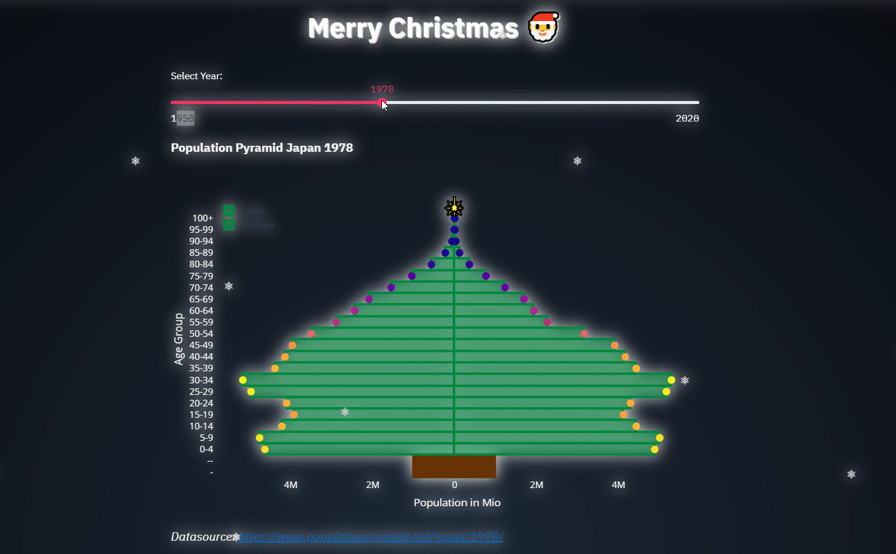

<!-- ABOUT THE PROJECT -->
## About The Project
Thanks for checking out this Christmas Population Pyramid. If you have a suggestion
that would make this better, please fork the repo and create a pull request.
Thanks again!

<!-- DEMO -->

    <a href="https://xmas-sven.herokuapp.com/">Check the app out here</a>
  

## Learn Excel Automation with Python
If this repo helped you, my [Excel Automation Course](https://pythonandvba.com/excel-automation-course/) teaches the full workflow from zero: Python for Excel users, xlwings, pandas and real projects.

Also check out my other [tools and templates](https://pythonandvba.com/solutions).

## Connect with Me
- **YouTube:** [CodingIsFun](https://youtube.com/c/CodingIsFun)
- **Website:** [PythonAndVBA](https://pythonandvba.com)
- **LinkedIn:** [Sven Bosau](https://www.linkedin.com/in/sven-bosau/)
- **Contact:** [Get in Touch](https://pythonandvba.com/contact)
## Support
If you find this project helpful, consider buying me a coffee. 

